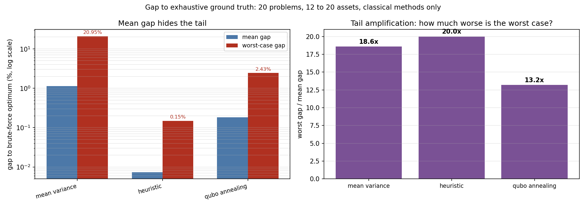
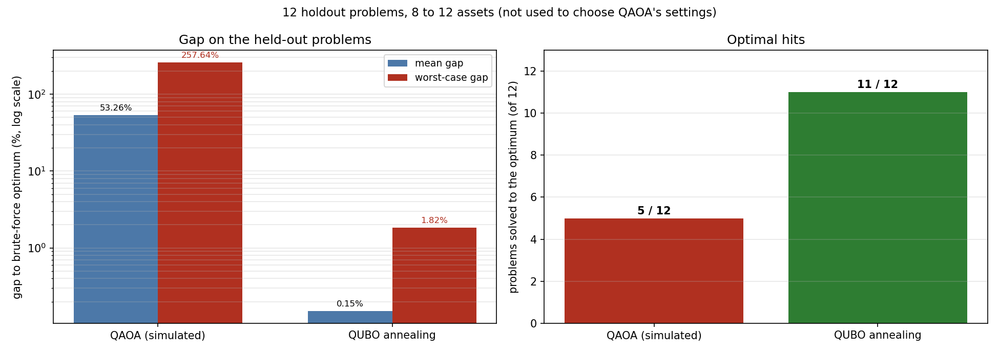
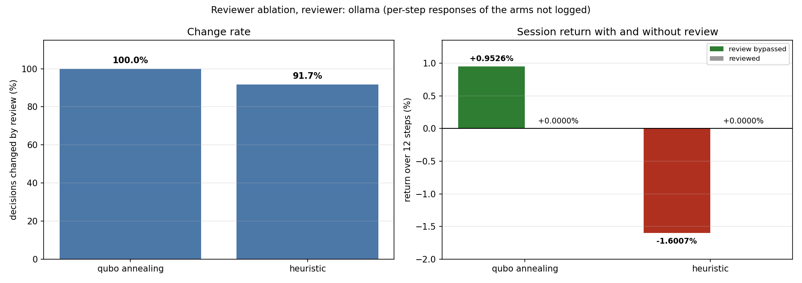
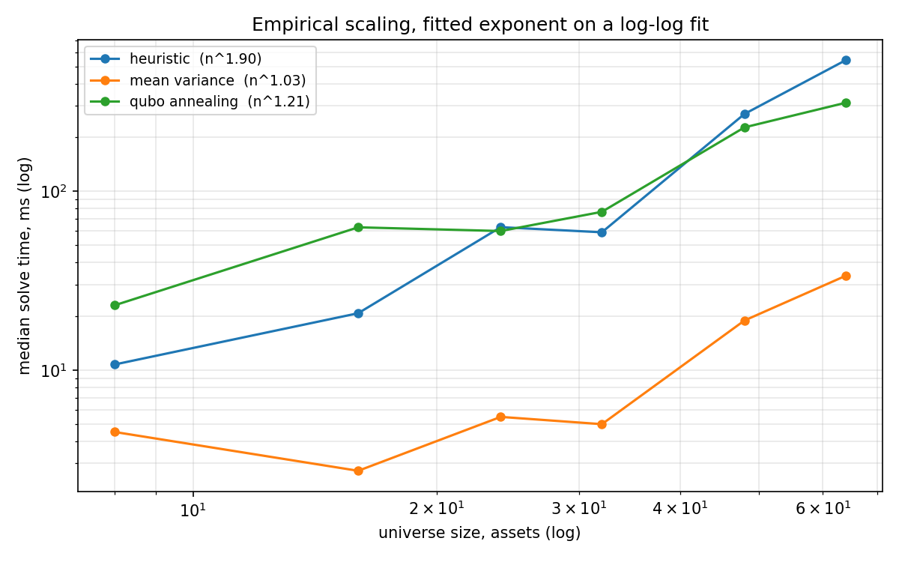
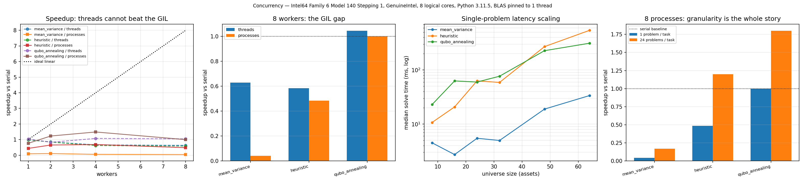
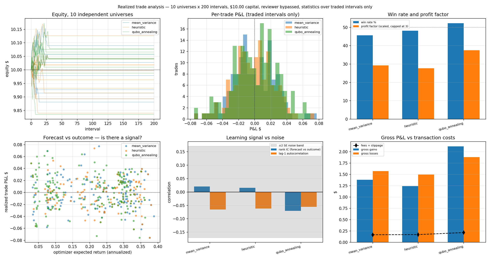
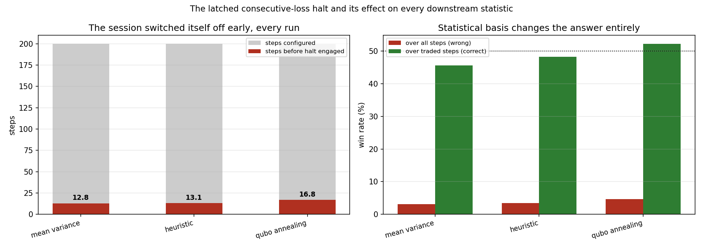

# Quantum-Inspired Portfolio Optimization

**Timeline:** August 2026

A Python research codebase that compares four ways to pick a cardinality-constrained portfolio: mean-variance with truncation, a classical heuristic, QUBO simulated annealing, and QAOA on a Qiskit statevector simulator. Where the universe is small enough to enumerate, each method is scored against the brute-force optimum. The methods are then replayed through a paper-trading loop in which a local language model reviews each candidate portfolio and a deterministic risk gate approves or rejects each entry order. The code runs offline on a synthetic price model and can use Alpaca paper-trading data when credentials are supplied. Its only network broker sends orders to `paper-api.alpaca.markets` and refuses any other host.

## How it works

- **One interface for four optimizers.** `MeanVarianceOptimizer`, `HeuristicOptimizer`, `QuboOptimizer` and `QaoaOptimizer` all implement `Optimizer.solve` and take the same `PortfolioProblem` (annualized expected returns, a Ledoit-Wolf shrunk covariance, and constraints for maximum weight, maximum positions and risk aversion). Timing and validation live in the shared base class, so runtime comparisons use identical inputs.
- **How each method handles the position cap.** Mean-variance solves the continuous quadratic program, keeps the largest holdings, and re-solves on that subset. The heuristic removes one asset at a time with a re-solve after each removal, then runs a bounded swap search (3 rounds, 5 candidates). QUBO annealing encodes the cap as a penalty, uses an equal-weight surrogate to choose the subset, and takes final weights from the same quadratic program as the other methods. QAOA builds the same objective and the same form of cardinality penalty as QUBO annealing, but with a stronger penalty multiplier (5.0 against 1.1), so the two matrices differ by the penalty term. It runs on a statevector simulator and is capped at 14 assets (`MAX_QUBITS`), a runtime limit and not a memory limit.
- **Ground truth by enumeration.** `exhaustive_best` scores every K-subset and refuses problems above 250,000 subsets (C(26,6) is accepted, C(27,6) is refused), so each method is measured as a gap to the true optimum and not only against the other methods. The gap divides by the size of the optimum, which is unstable when the optimum is near zero, so `shortfall_to` gives the same difference in objective units and the sweep reports both.
- **Return estimators.** Five estimators (sample mean, grand mean, James-Stein, momentum, trend quality) feed a walk-forward grid in `scripts/estimator_vs_optimizer.py`.
- **Data sources behind one interface.** `SyntheticBarSource` is a three-factor price model that needs no credentials, `AlpacaBarSource` calls the Alpaca REST API with `requests` and gathers rows per symbol across result pages, and `CsvBarSource` replays files for regression tests. The default universe has 16 US large caps.
- **The reviewer can only subtract.** It returns APPROVE, REJECT or ABSTAIN and nothing else. Its prompt contains no order quantities, prices or balances. Every citation it makes is checked against a knowledge base of 16 formula records. During a review, any failure (unreachable model, malformed output, invented citation) maps to ABSTAIN. Backends are Ollama (default model `llama3.2:3b`), `llama-server`, and a rule-based offline stand-in that is labelled as such in every result. Both model backends accept only an `http` endpoint whose host is `127.0.0.1`, `localhost` or `::1`, with no embedded user name or password. One path is outside the review itself: if no model is reachable at startup, `resolve_reviewer` silently returns the offline stand-in, whose rules can approve. `scripts/run_session.py` refuses to run in that case unless `--offline` is passed.
- **The risk gate approves or rejects each entry.** `RiskGate` has 18 reject reasons and checks each entry order against the account state and the policy. Malformed input is rejected and not approved: a side other than buy or sell, a reference price that is not finite and positive, a notional that is not finite, a spread that is negative or not finite, a stop that is not a finite price above zero and below the entry, a quote stamped after the decision time, and a non-finite account figure, which halts trading. It does not choose the order size. `SessionRunner` proposes a fixed 1.50 USD notional per entry (`SessionConfig.position_notional_usd`, capped at the policy's 3 USD single-position limit), and the gate accepts or rejects that order and derives its stop price from the 0.10 USD per-trade loss limit. The end-of-step flattening sell goes straight to the broker without a second gate check, by design. The default policy is 10 USD starting capital, a 3 USD single-position cap, 4 open positions, a 5 percent drawdown limit, and a halt after 3 consecutive losses. Stop-losses are checked client-side. `must_flatten` and the kill switch are available controls with tests, and `SessionRunner` calls neither.
- **Execution.** `SimulatedBroker` fills orders locally. `AlpacaPaperBroker` raises `LiveTradingDisabled` unless the base URL uses `https`, has the host `paper-api.alpaca.markets` exactly, and carries no embedded credentials. `LiveDisabledBroker` raises on every call. `SessionRunner` replays history and accepts only a `SimulatedBroker`; it raises `TypeError` for any other broker.
- **Decision cycle and ablation.** `SessionRunner` runs one step per row of the price frame: data, features, optimizer, a fixed set of four evidence records, reviewer, risk gate, paper order, report. Every script in this repository feeds it daily bars, so a step is one trading day and the 10-minute spacing in the report timestamps is a label. The gate's stale-quote check cannot fire in this replay, because the quote time is the decision time. A close that is missing, infinite or not positive is treated as missing and carried forward from the last good close; a symbol with no earlier good close is left out of every step whose training window it does not fill. It joins the problem on the first step whose window holds a close for it on every row, and `symbols_considered` in the step report shows the smaller universe until then. If no symbol fills the window the run raises `InsufficientHistory`. `compare_review_ablation` replays the same seed with review on and off to measure what the reviewer changes.

## Results

All results use synthetic prices unless stated otherwise. The numbers below come from runs on 2026-10-21 with the commands in the next section, except where a sentence says otherwise.

- **Gap to optimum, 20 synthetic problems** (12 assets with cap 4, 16 with cap 4, 16 with cap 6, and 20 with cap 5, five seeds each, exhaustive ground truth, `scripts/validate_against_optimum.py`):

  | method | mean gap | worst gap | optimal hit rate |
  |---|---|---|---|
  | heuristic | 0.007% | 0.148% | 95% |
  | QUBO annealing | 0.184% | 2.428% | 70% |
  | mean-variance | 1.127% | 20.951% | 80% |

  Mean-variance is close to optimal on average and 20.951% off on its worst case. QUBO annealing stays within 2.428% on these 20 problems, but that is a property of this battery and not a bound. In the scalability sweep, which has nine problems with ground truth, single QUBO gaps reached 8.449% (8 assets), 12.427% (16 assets) and 9.839% (32 assets), and truncation reached 29.493% at 32 assets.
- **QAOA on held-out problems.** On 12 problems (8 to 12 assets) that were not used to pick its settings, QAOA had a mean gap of 53.256%, a worst gap of 257.641%, and reached the optimum on 5 of 12. QUBO annealing on the same 12 had a mean gap of 0.152% and reached the optimum on 11 of 12. The same settings scored 0.000% on the six cases they were tuned on, which `scripts/validate_qaoa_holdout.py` reports as overfitting. QAOA averaged 3859 ms per problem against 56 ms for annealing (68 times slower). Both scripts ran QAOA with 250 optimizer iterations, and the library default is 120.
- **Runtime scaling.** The sweep in `reports/table_runtime_ms.csv` (median of 3 repeats, 300-session window) shows at 64 assets: mean-variance 21.8 ms, QUBO annealing 284.5 ms, heuristic 458.7 ms. At 8 assets QAOA took 979.8 ms against 36.6 ms for QUBO annealing.
- **Reviewer ablation with a model.** In the committed log (`llama3.2:3b` through Ollama, 12 steps on synthetic daily bars) the reviewer abstained on all 12 steps of the main run: 11 with a verdict from the model and no error, and one where the citation check refused an invented source id. The ablation block of the same file reports that review changed 12 of 12 QUBO decisions and 11 of 12 heuristic decisions, with no trade in either arm when review was on (returns of +0.9526% and -1.6007% without review, 0.0000% with). The two arms make their own reviewer calls and the file holds only their totals, so it cannot show that the model answered in them, and its `reviewer_is_language_model` flag was set from the backend name. `scripts/run_session.py` now stops without writing when a model returns no response at any step, logs every step of both arms, and sets the flag from the responses. The committed file was written before that change. The result shows that review blocks trades in this setup and does not show that the reviewer separates good trades from bad ones. `docs/FINDINGS.md` section 7 has the detail.
- **Stated limits.** Synthetic prices have constant per-asset drift, so the estimator comparison needs a re-run on real data. A 30-session lookback gives 29 return observations and a singular covariance above 28 assets (30 calendar days is about 21 observations). Ground truth is refused above 250,000 subsets. The default Alpaca feed is IEX, a single exchange, so bars can differ from full-market data; set `ALPACA_DATA_FEED=sip` for the full market. Paper fills exclude slippage and market impact.

### Figures



*Mean and worst-case gap for the three classical methods on the 20-problem battery. QAOA is not drawn here: it was not run on this battery, because 15 of the 20 problems have more than its 14-asset cap and the five 12-asset problems were left out.*



*QAOA against QUBO annealing on the 12 held-out problems of 8 to 12 assets.*



*Totals from the ablation block of `reports/session_intervals.json`. The figure title says whether the log records the model's response at every step of both arms.*



*Median solve time from 8 to 64 assets for mean-variance, the heuristic and QUBO annealing, with the log-log fitted exponent in the legend. Data from `reports/concurrency.json`.*



*Output of `scripts/benchmark_concurrency.py`: speedup of thread and process pools over a serial loop, single-problem latency by universe size, and the effect of putting 24 problems in one process task. The machine and Python version are in the figure title.*



*Output of `scripts/analyze_trades.py`: equity, per-trade profit and loss, win rate, forecast against outcome and gross profit and loss against costs for the three classical methods, with the reviewer bypassed.*



*From `reports/trade_analysis.json`: how many steps of each run the latched halt left, and the win rate counted over all steps against traded steps only.*

The architecture, the decision pipeline, the reviewer states, the QUBO method, the ablation and the halt latch are drawn as Mermaid diagrams in [`docs/DIAGRAMS.md`](docs/DIAGRAMS.md). Their sources are the `.mmd` files in `docs/diagrams/`.

## Build and run

Requires Python 3.11 or newer. The core install pulls in NumPy, pandas, SciPy, Matplotlib, requests and PyArrow. The `quantum` extra adds Qiskit, which is the only package the QAOA path needs.

```bash
pip install -e ".[dev]"
pip install -e ".[dev,quantum]"      # adds Qiskit for QAOA
```

`pip wheel . --no-deps --no-build-isolation`, run on a temporary copy of this directory on 2026-10-21, produced `quantlab-0.1.0-py3-none-any.whl` without error.

Run scripts from the repository root with `PYTHONPATH=src`:

```bash
PYTHONPATH=src python scripts/validate_against_optimum.py   # gap-to-optimum table, add --json PATH to save it
PYTHONPATH=src python scripts/validate_qaoa_holdout.py      # QAOA holdout check, needs Qiskit
```

Both commands were run on 2026-10-21 and finished in about 223 seconds and 76 seconds. They print their results and write a file only when `--json PATH` is given.

The other scripts and the files they write under `reports/`:

| script | produces |
|---|---|
| `scalability_sweep.py` | runtime, gap, worst-gap and shortfall tables, `reports/scalability.png`, 4 to 64 assets (run on 2026-10-21) |
| `run_session.py` | the step log and the reviewer ablation in `reports/session_intervals.json` (needs a local Ollama model, or `--offline` for the labelled stand-in; run on 2026-10-21) |
| `estimator_vs_optimizer.py` | walk-forward estimator by optimizer grid (run on 2026-10-21) |
| `diagnose_qubo.py` | separates model loss from search loss in the QUBO method (not re-run) |
| `tune_qaoa.py` | QAOA depth and penalty sweep (not re-run) |
| `debug_qaoa_case.py` | one QAOA case in detail, with gap and absolute shortfall |
| `build_problem.py` | covariance rank by lookback and universe size (not re-run) |
| `compare_smoke.py` | checks that the methods diverge and the cap binds (not re-run) |
| `analyze_trades.py` | realized trade statistics and a test for any learnable signal (not re-run) |
| `benchmark_concurrency.py` | serial, thread and process speedups on 48 problems of 24 assets; it refuses to write a run whose speedups exceed the worker count or whose serial times disagree (run on 2026-10-21) |
| `check_alpaca.py` | read-only Alpaca preflight (unverified, needs paper credentials) |
| `make_figures.py` | figures in `reports/figures/`, read from the JSON files in `reports/` |
| `render_diagrams.ps1` | renders `docs/diagrams/*.mmd` into PNG files (PowerShell, needs Mermaid CLI, not committed) |

`reports/` holds the small committed outputs these scripts wrote, so the figures and the numbers above can be checked without re-running anything. Files from scripts marked "not re-run" are from earlier runs. To use Alpaca paper data, copy `.env.example` to `.env` in the directory you run from, or in the directory named by the `QUANTLAB_HOME` environment variable, and fill in paper-trading keys. The bar cache `data_cache/` goes in the same directory. `.env` is ignored by git. A trailing `/v2` on the endpoint URL is stripped on load.

## Tests

```bash
python -m pytest tests -q
```

On 2026-10-21 this gave **451 passed** in 146.60 seconds with Python 3.11.5, Qiskit 1.4.6, NumPy 1.26.4 and SciPy 1.12.0, with no failures and no skips. The suite does not need `qiskit-algorithms` or `qiskit-optimization`, which are installed on the machine that produced these numbers: this run made them, `qiskit-aer`, `yaml` and `alpaca` unimportable and still passed with no skips. The suite covers 10 test files, including a gap-to-optimum quality budget for each classical optimizer (`tests/test_ground_truth.py`) and 157 tests in `tests/test_risk_and_execution.py` covering the risk gate, the brokers and the reviewer guards. No `.env` file was present when it ran.

## Background

Implementation for Project II, "Implementing and Evaluating Quantum Inspired, Agentic Algorithms for Financial Portfolio Optimization and Risk Management". Project I and the proposal are earlier documents of the same project and are not included here. The code and `docs/FINDINGS.md` refer to them for the 30-session covariance window and the required reviewer ablation.

## License

MIT, see `LICENSE`.
