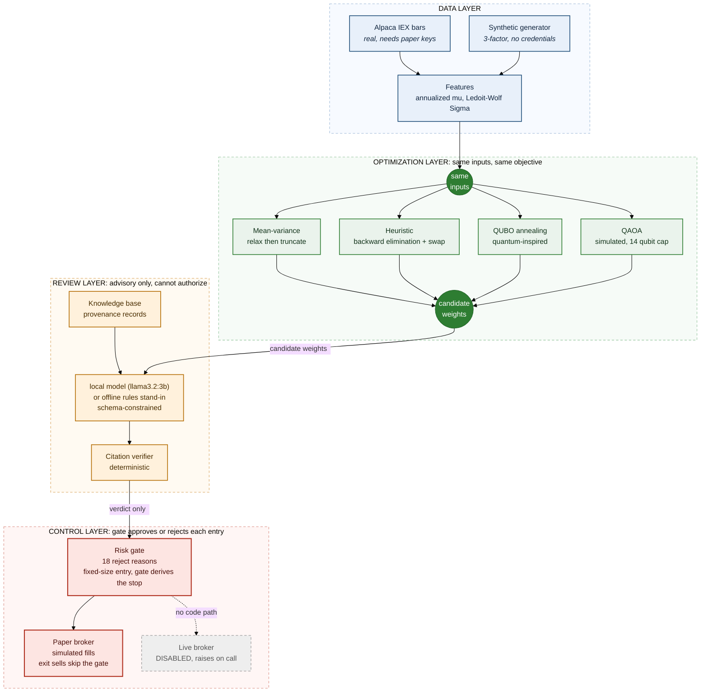
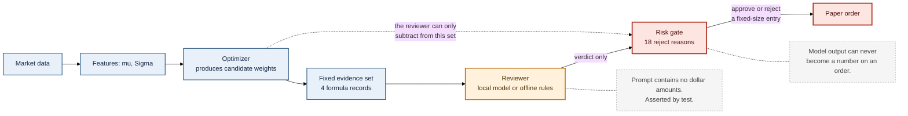
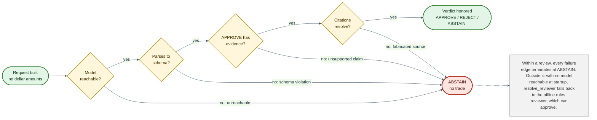
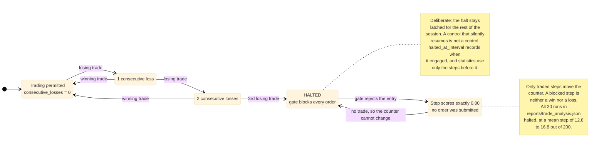

# Diagrams

Each diagram below is also a standalone Mermaid file in `docs/diagrams/`, which
`scripts/render_diagrams.ps1` renders to PNG. This page holds the same text as
fenced `mermaid` blocks so GitHub draws them in place.

## Architecture

The modules and what each one is allowed to touch. Source: `docs/diagrams/architecture.mmd`.

## Decision pipeline

One step of `SessionRunner`, from data to report. Source: `docs/diagrams/pipeline.mmd`.

## Reviewer states

Every failure inside a review ends in ABSTAIN. Source: `docs/diagrams/reviewer_states.mmd`.

## QUBO method

How the cardinality cap becomes a penalty and how the weights are set. Source: `docs/diagrams/qubo.mmd`.

```mermaid
---
config:
  theme: base
  themeVariables:
    fontFamily: "Arial, Helvetica, sans-serif"
    fontSize: "15px"
---
flowchart LR
    IN["Inputs<br/>mu, Sigma, lambda, K, w_max"]

    IN --> Q1["Build QUBO<br/>E(x) = -(1/K) mu'x + (lambda/K^2) x'Sigma x + P(sum x - K)^2"]
    Q1 --> Q2["Expand using x_i squared = x_i<br/>gives symmetric Q with E(x) = x'Qx"]
    Q2 --> Q3{"Move type?"}

    Q3 -- "single bit flip<br/>(naive)" --> BAD["Cardinality changes<br/>penalty activates and dominates<br/>search degenerates to any feasible subset"]
    Q3 -- "swap: one held for one unheld<br/>(this implementation)" --> GOOD["State never leaves exactly-K set<br/>penalty contributes EXACTLY ZERO to delta E<br/>pure objective landscape is searched"]

    GOOD --> ANN["Metropolis annealing<br/>delta E = 2(h_j - h_i) + Q_ii + Q_jj - 2Q_ij<br/>O(1) to evaluate, O(n) to apply"]
    ANN --> REP["Repair to exact cardinality<br/>feasibility guaranteed, not hoped for"]
    REP --> QP["Continuous weights from the SAME QP<br/>every other method uses"]
    QP --> OUT["Portfolio weights<br/>comparison isolates SELECTION, not weighting"]

    classDef good fill:#E3F5E6,stroke:#2E7D32,stroke-width:2px,color:#12331A
    classDef bad fill:#FDE5E2,stroke:#B03020,stroke-width:2px,color:#4A0F0A
    classDef step fill:#E8F0FA,stroke:#1F4E79,stroke-width:1.5px,color:#12263F
    class GOOD,OUT good
    class BAD bad
    class IN,Q1,Q2,ANN,REP,QP step
```

## Reviewer ablation

The two arms of `compare_review_ablation` and how they are compared. Source: `docs/diagrams/ablation.mmd`.

```mermaid
---
config:
  theme: base
  themeVariables:
    fontFamily: "Arial, Helvetica, sans-serif"
    fontSize: "15px"
---
flowchart LR
    SEED["Identical seed, prices,<br/>optimizer and estimator"]

    SEED --> ARM1
    SEED --> ARM2

    subgraph ARM1["Arm A: review enabled"]
        direction TB
        O1["Optimizer produces candidate"]
        R1["LLM reviewer"]
        G1["Risk gate"]
        T1["0 of 12 steps traded<br/>(both optimizers)"]
        O1 --> R1 --> G1 --> T1
    end

    subgraph ARM2["Arm B: review bypassed"]
        direction TB
        O2["Optimizer produces candidate"]
        B2["Reviewer skipped<br/>recorded as BYPASSED, not APPROVE"]
        G2["Risk gate"]
        T2["QUBO: 12 of 12 steps traded<br/>heuristic: 11 of 12"]
        O2 --> B2 --> G2 --> T2
    end

    T1 --> CMP
    T2 --> CMP

    CMP{"Compare<br/>decision by decision"}
    CMP --> RES

    RES["100 percent of QUBO decisions changed<br/>(heuristic: 91.7 percent)<br/><br/>But: no trade in either arm with review on.<br/>Main-run log: 12 abstentions<br/>(11 verdicts, 1 failed citation check).<br/>Review avoided the heuristic loss of -1.6007 percent<br/>AND forfeited the QUBO gain of +0.9526 percent."]

    VERDICT["Degenerate result.<br/>Uniformly conservative, not selective.<br/>Safety property holds. Decision value not supported."]
    RES --> VERDICT

    classDef arm fill:#E8F0FA,stroke:#1F4E79,stroke-width:1.5px,color:#12263F
    classDef warn fill:#FDE5E2,stroke:#B03020,stroke-width:2.5px,color:#4A0F0A
    classDef neutral fill:#F5F5F5,stroke:#777777,color:#222222
    class O1,R1,G1,O2,B2,G2 arm
    class VERDICT,RES warn
    class SEED,CMP,T1,T2 neutral
    style ARM1 fill:#FFFAF2,stroke:#D9A45B,stroke-dasharray: 4 3
    style ARM2 fill:#F7FAFF,stroke:#9DB8D6,stroke-dasharray: 4 3
```

## Halt latch

The consecutive-loss halt stays engaged for the rest of a session. Source: `docs/diagrams/halt_latch.mmd`.

